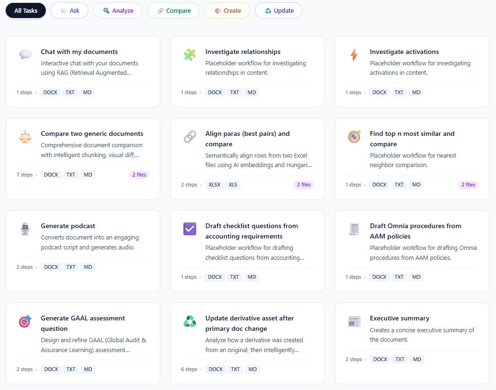

# MCP Server – Tool Details and Specifications

#### Overview 
The legacy `catalyst-nextgen-ui-poc` codebase was extended to support a **Modular MCP Server architecture** using FastMCP 2.0 python library. This architecture introduces:
- Centralized Tool Registry and standardized **tool contracts** (JSON Schem
- Standardized tool contracts (JSON schemas)
- Input adapters to enable dynamic tool discovery and execution via REST endpoints and MCP protocol.
####
___

### 1. Context

**Ink v2** (Python, FastAPI) exposes **APIs/endpoints** consumed by web UI, and these endpoints expose different functionalities consumed by the application:

The **Transformations APIs** manage **Tasks** (workflows of steps); each **step** executes a **tool** (e.g., Find information, Convert text to audio).

Currently, the PoC UI shows **12 Tasks** and **8 tool types** available in the Ink web UI.



#### Tool types:
- LLM Prompt
- Web Search
- Fact Check
- Data Validation
- Content Enrichment
- Podcast Generation
- Excel Alignment
- Compare Analysis

In fact, there are **18 usable tools** (`agentic_tools.py`), for example, the JSON schema of the workflow "Compare two generic documents" includes some not visible in the web UI:

**Task and step JSON example**
```json
{
    "key": "compare_documents",
    "name": "Compare two generic documents",
    "description": "Comprehensive document comparison with intelligent chunking, visual diff, structural analysis, semantic matching, and detailed AI-powered change analysis. Handles documents from 1-1000 pages.",
    "icon": "⚖️",
    "canvas_type": "diff_viewer",
    "input_file_types": [
        "docx",
        "txt",
        "md",
        "pdf"
    ],
    "category": "compare",
    "requires_dual_upload": true,
    "steps": [
        {
            "step_name": "Extract & Chunk Documents",
            "step_type": "smart_chunker",
            "description": "Intelligently segment documents based on structure and size, generate embeddings for semantic matching"
        },
        {
            "step_name": "Generate Visual Diff",
            "step_type": "enhanced_diff",
            "description": "Create word-level redline/greenline comparison with statistics and change tracking"
        },
        {
            "step_name": "Structural Analysis",
            "step_type": "structural_analysis",
            "description": "Compare document outlines, heading hierarchies, and detect reorganization"
        },
        {
            "step_name": "Semantic Analysis",
            "step_type": "semantic_diff",
            "description": "Find semantically matched chunks, detect moved/paraphrased content, identify truly new/removed sections"
        },
        {
            "step_name": "Extract Statistics Summary",
            "step_type": "comparison_summary",
            "description": "Extract key statistics from all previous analysis steps for efficient LLM processing"
        },
        {
            "step_name": "Content Change Analysis",
            "step_type": "llm_prompt",
            "prompt": "You are performing a comprehensive content change analysis between two documents.\n\n### Document Comparison Statistics\n\n{previous_output}\n\n### Your Task\n\nBased on the available analysis, categorize and explain the changes:\n\n1. **Factual Updates** - Changed data, numbers, dates, names\n2. **Policy Changes** - Modified requirements, rules, procedures\n3. **Clarifications** - Reworded for clarity without changing meaning\n4. **Additions** - New sections, paragraphs, or concepts introduced\n5. **Removals** - Content deleted from the first document\n6. **Structural Changes** - Reorganizations, reorderings, heading changes\n7. **Semantic Shifts** - Paraphrased content or meaning changes\n\n### Required Output Format\n\nProvide a structured analysis with these sections:\n\n#### Executive Summary\n- Brief overview of the nature and scale of changes (2-3 sentences)\n- Overall assessment: Minor edits, Moderate revision, Major overhaul, or Complete rewrite\n\n#### Change Breakdown by Category\nFor each category above (that has changes):\n- **Category Name** (e.g., Factual Updates)\n  - Number of changes detected\n  - Key patterns observed\n  - Impact assessment (High/Medium/Low)\n\n#### Key Insights\n- Most significant types of changes\n- Areas of greatest modification\n- Consistency of changes (systematic vs. scattered)\n\n#### Impact Assessment\n- What are the implications of these changes?\n- Who would be affected?\n- What actions might be required?\n\n#### Summary Statistics\nBased on the previous steps:\n- Estimated change volume\n- Change distribution across document\n- Overall similarity assessment\n\nProvide your analysis in clear Markdown format."
        },
        {
            "step_name": "Synthesis Report",
            "step_type": "llm_prompt",
            "prompt": "Create a comprehensive, executive-ready comparison report synthesizing the analysis.\n\n### Analysis Summary\n\nYou have access to the Content Change Analysis from the previous step:\n\n{previous_output}\n\n### Your Task\n\nCreate a final synthesis report that presents the findings in an executive-ready format.\n\n### Required Structure\n\n# Document Comparison Report\n\n## Overview\n- Comparison Date: [current date]\n- Analysis Method: Multi-level (Visual, Structural, Semantic, Content)\n- Document Scope: [estimate based on analysis]\n\n## Executive Summary\n[2-3 paragraph high-level overview of changes - suitable for executives who won't read the full report]\n\n## Key Findings\n[Present the most critical insights from the analysis]\n\n### Change Categorization\n[Organize changes by type: Factual Updates, Policy Changes, Clarifications, Additions, Removals, Structural Changes, Semantic Shifts]\n\n### Impact Analysis\n[What do these changes mean? Who is affected? What actions are needed?]\n\n## Change Statistics Summary\n[Present statistics in clear, visual format - use tables where appropriate]\n\n## Detailed Breakdown\n[More detailed analysis organized by importance and category]\n\n## Recommendations\n\n### For Reviewers\n- Focus areas for review\n- Critical changes requiring attention\n- Validation checkpoints\n\n### For Implementers\n- Action items based on changes\n- Priority sequence\n- Dependencies to consider\n\n### For Stakeholders\n- Who needs to be informed\n- Communication priorities\n- Approval requirements\n\n## Conclusion\n[Final assessment and next steps]\n\n---\n\nProvide the complete synthesis report in well-formatted Markdown with clear headings and professional presentation."
        }
    ]
}
```

####
___

### 2. How the MCP Server Works

A layer was created to host the MCP Server, mounted on top of the existing APIs/endpoints to convert each one into an MCP-compliant tool that can be consumed by any AI Agent or client supporting the MCP protocol.

Since the internal code of each API remains unchanged thanks to the **Fast MCP v2** library, tasks can be managed and executed in two ways:
- Directly via the legacy endpoint
- Through the MCP Server

Additionally, tools were created in the MCP Server to allow an AI Agent to use each of the 18 project tools (or restrict to the 7 UI tools) independently. This is possible because the JSON structures of each MCP tool can consume memory (previous output) states and files (document content). Example MCP tool schema:

```json
{
  "skillId": "llm_prompt",
  "skillName": "LLM Prompt",
  "skillType": "processing",
  "mcpUri": "mcp://catalyst-mcp/tools/llm_prompt",
  "inputFileRequirements": {
    "minFiles": 0,
    "maxFiles": 0,
    "exactFiles": 0,
    "description": "No file uploads; provide 'prompt' and optional context"
  },
  "entryCriteria": {
    "requiredInputs": [
      "prompt",
      "document_content",
      "previous_output",
      "template_variables",
      "user_options",
      "labeled_documents",
      "step_history"
    ],
    "inputFormats": ["txt", "json"]
  },
  "exitCriteria": {
    "outputFormat": "txt"
  },
  "requiresPrompt": true,
  "executionEndpoint": "/api/tool/execute"
}
```

#### In summary:
- MCP layer wraps FastAPI routes using `fastmcp` and an explicit allow-list.
- Tools are exposed as MCP-compliant endpoints with descriptors.
- Skill descriptors are generated from contracts or docstrings.
- No new skills are created, the MCP Server reuses the existing skills defined in the legacy `agentic_tools.py` file.
- Clients interact via standardized MCP URIs and execution endpoints. This means any AI agent compatible with the MCP protocol can discover and execute them directly.
####


#### MCP Server impact:
- Enables dynamic tool discovery and execution via MCP protocol.
- Improves modularity and scalability for AI-driven workflows.
- Maintains backward compatibility with legacy endpoints.
- Facilitates future interoperability with MCP clients and ecosystems.
####
___

### 3. Summary of Code Changes
 
Updates to the MCP Server implementation applied to the legacy codebase

#### Key Additions
- **New Directories**
    - `app/utils/` → MCP utilities and adapters
    - `tools/` → MCP-compliant tools extracted from legacy agentic_tools.py
- **New Core File**
    - `app_host.py` → MCP Server host implementation
    - `Dockerfile` → Containerization support
#### Modified Files
- `app_fastapi.py` → Endpoints for tool listing and execution
- `config.py` → Added MCP-related configuration constants
- `requirements.txt` → Added fastmcp=2.14.1
- `start_fastapi.py` → Mount MCP server routes alongside FastAPI app 
####
___

### 4. Full Endpoint Inventory (Legacy + MCP)
 
Includes legacy endpoints, and two new endpoints that allow direct access to all 18 types of tools:

| **Method** | **Route** | **Summary** | **MCP Tool** |
|---|---|---|---|
| GET | / | Landing page |  |
| GET | /studio | Studio main UI |  |
| GET | /workflow-builder | Workflow Builder UI |  |
| GET | /api/canvas-types | Get Canvas Types |  |
| GET | /api/canvas-type/{canvas_type_id} | Get Canvas Type |  |
| GET | /api/transformations | Get Transformations | get_transformations_api_transformations_get |
| GET | /api/transformation/{transformation_key} | Get Transformation | get_transformation_details_api_transformation |
| PUT | /api/transformation/{transformation_key} | Update Transformation | update_transformation_api_transformation |
| DELETE | /api/transformation/{transformation_key} | Delete Transformation | delete_transformation_api_transformation |
| POST | /api/transformation | Add Transformation | add_transformation_api_transformation_post |
| POST | /api/transformation/{transformation_key}/duplicate | Duplicate Transformation | duplicate_transformation_api_transformation |
| GET | /api/transformation/{transformation_key}/export | Export Transformation | export_transformation_api_transformation |
| POST | /api/transformation/import | Import Transformation | import_transformation_api_transformation_import_post |
| GET | /api/audio/{filename} | Serve Audio |  |
| POST | /api/upload-labeled | Upload Labeled Document |  |
| POST | /api/upload | Upload Document |  |
| POST | /api/upload-dual | Upload Dual Documents |  |
| GET | /api/stream/{transformation_key} | Stream Transformation (SSE) | stream_transformation_api_stream |
| POST | /api/session/reset | Reset Session | reset_session_api_session_reset_post |
| POST | /api/chat | Chat With Documents (RAG) | chat_with_documents_api_chat_post |
| POST | /api/export | Export Document |  |
| **GET** | **/api/tools** | **List Registered Tools** (New) | **list_registered_tools_api_tools_get** |
| **POST** | **/api/tool/execute** | **Execute Tool Generic** (New) | **execute_tool_generic_api_tool_execute_post** |

####
___

### 5. MCP Server Tools
 
Two new tools:
- **List Registered Tools** → Displays 18 MCP tools with descriptors.
- **Execute Tool Generic** → Executes a specific skill dynamically via MCP adapter.
#### Summary of 18 Skills
<table>
<tr>
<th> 
</th>
<th> 
Skill Name
</th>
<th> 
Skill ID
</th>
<th> 
Key Inputs
</th>
<th> 
Output Format
</th>
<th> 
Notes
</th>
</tr>
<tr>
<td> 
1
</td>
 
 <td> 
LLM Prompt
</td>
<td> 
llm_prompt
</td>
<td> 
prompt, document_content, previous_output
</td>
<td> 
txt
</td>
<td> 
Prompt-based generation
</td>
</tr>
<tr>
<td> 
2
</td>
 
 <td> 
Web Search
</td>
<td> 
web_search
</td>
<td> 
search_query, max_results
</td>
<td> 
txt
</td>
<td> 
Web search
</td>
</tr>
<tr>
<td> 
3
</td>
 
 <td> 
Document Analysis
</td>
<td> 
document_analysis
</td>
<td> 
document_content, analysis_type
</td>
<td> 
txt
</td>
<td> 
Document analysis
</td>
</tr>
<tr>
<td> 
4
</td>
 
 <td> 
Fact Check
</td>
<td> 
fact_check
</td>
<td> 
previous_output
</td>
<td> 
txt
</td>
<td> 
Fact verification
</td>
</tr>
<tr>
<td> 
5
</td>
 
 <td> 
Content Enrichment
</td>
<td> 
content_enrichment
</td>
<td> 
previous_output, enrichment_topic
</td>
<td> 
txt
</td>
<td> 
Content enrichment
</td>
</tr>
<tr>
<td> 
6
</td>
 
 <td> 
Data Validation
</td>
<td> 
data_validation
</td>
<td> 
previous_output, validation_type
</td>
<td> 
txt
</td>
<td> 
Data validation
</td>
</tr>
<tr>
<td> 
7
</td>
 
 <td> 
Podcast Generator
</td>
<td> 
podcast_generator
</td>
<td> 
previous_output, document_content
</td>
<td> 
mp3
</td>
<td> 
Audio generated
</td>
</tr>
<tr>
<td> 
8
</td>
 
 <td> 
Excel Column Alignment
</td>
<td> 
alignment
</td>
<td> 
file1_path, file2_path, user_options
</td>
<td> 
json
</td>
<td> 
Semantic alignment
</td>
</tr>
<tr>
<td> 
9
</td>
 
 <td> 
Compare Analysis
</td>
<td> 
compare_analysis
</td>
<td> 
previous_output
</td>
<td> 
json
</td>
<td> 
Analysis of aligned pairs
</td>
</tr>
<tr>
<td> 
10
</td>
 
 <td> 
RAG Setup
</td>
<td> 
rag_setup
</td>
<td> 
all_documents
</td>
<td> 
json
</td>
<td> 
Vectorstore ready
</td>
</tr>
<tr>
<td> 
11
</td>
 
 <td> 
Redline Diff
</td>
<td> 
redline_diff
</td>
<td> 
doc1_path, doc2_path
</td>
<td> 
json
</td>
<td> 
Word-level markup
</td>
</tr>
<tr>
<td> 
12
</td>
 
 <td> 
Derivative Analysis
</td>
<td> 
derivative_analysis
</td>
<td> 
labeled_documents
</td>
<td> 
txt
</td>
<td> 
Derivative analysis
</td>
</tr>
<tr>
<td> 
13
</td>
 
 <td> 
Update Derivative
</td>
<td> 
update_derivative
</td>
<td> 
labeled_documents, previous_output
</td>
<td> 
txt
</td>
<td> 
Updated derivative
</td>
</tr>
<tr>
<td> 
14
</td>
 
 <td> 
Smart Chunker
</td>
<td> 
smart_chunker
</td>
<td> 
doc1_path, doc2_path
</td>
<td> 
json
</td>
<td> 
Strategy, chunks
</td>
</tr>
<tr>
<td> 
15
</td>
 
 <td> 
Enhanced Diff
</td>
<td> 
enhanced_diff
</td>
<td> 
doc1_path, doc2_path
</td>
<td> 
json
</td>
<td> 
Visual markup
</td>
</tr>
<tr>
<td> 
16
</td>
 
 <td> 
Structural Analysis
</td>
<td> 
structural_analysis
</td>
<td> 
doc1_path, doc2_path
</td>
<td> 
json
</td>
<td> 
Hierarchy comparison
</td>
</tr>
<tr>
<td> 
17
</td>
 
 <td> 
Semantic Diff
</td>
<td> 
semantic_diff
</td>
<td> 
previous_output, doc1_path, doc2_path
</td>
<td> 
json
</td>
<td> 
Semantic matches
</td>
</tr>
<tr>
<td> 
18
</td>
 
 <td> 
Comparison Summary
</td>
<td> 
comparison_summary
</td>
<td> 
step_history
</td>
<td> 
txt
</td>
<td> 
Comparison summary
</td>
</tr>
</table>

___
### 6. How MCP is wired in code (annotated)
 
Below is the **exact MCP host code** currently used, enriched with comments to explain how the MCP layer works, how the allow-list maps FastAPI routes into MCP tools, and how the container mounts health + correlation middleware. 
```Python
from contextlib import asynccontextmanager
from fastapi import FastAPI, Request, HTTPException
from fastapi.responses import JSONResponse
from fastmcp import FastMCP
from fastmcp.server.openapi import RouteMap, MCPType
\# Import your current FastAPI app \(must expose: app = FastAPI\(...\)\)
from app_fastapi import app as rest_app
\# 1\) Allow-list: authoritative mapping of REST endpoints → MCP tools
\# \- Each RouteMap declares accepted HTTP methods and a path regex pattern.
\# \- mcp_type=MCPType.TOOL means the endpoint becomes an MCP-discoverable tool.
\# \- A final EXCLUDE acts as catch-all so NOTHING else is exposed.
ALLOWLIST_ROUTE_MAPS = \[
 \# /api/transformations \(listing and CRUD\)
 RouteMap\(methods=\["GET"\], pattern=r"^/api/transformations$", mcp_type=MCPType.TOOL\),
 RouteMap\(methods=\["POST"\], pattern=r"^/api/transformation$", mcp_type=MCPType.TOOL\),
 RouteMap\(methods=\["GET"\], pattern=r"^/api/transformation/\\\{transformation_key\\\}$", mcp_type=MCPType.TOOL\),
 RouteMap\(methods=\["PUT"\], pattern=r"^/api/transformation/\\\{transformation_key\\\}$", mcp_type=MCPType.TOOL\),
 RouteMap\(methods=\["DELETE"\],pattern=r"^/api/transformation/\\\{transformation_key\\\}$", mcp_type=MCPType.TOOL\),
 RouteMap\(methods=\["POST"\], pattern=r"^/api/transformation/\\\{transformation_key\\\}/duplicate$", mcp_type=MCPType.TOOL\),
 RouteMap\(methods=\["GET"\], pattern=r"^/api/transformation/\\\{transformation_key\\\}/export$", mcp_type=MCPType.TOOL\),
 RouteMap\(methods=\["POST"\], pattern=r"^/api/transformation/import$", mcp_type=MCPType.TOOL\),
 \# /api/audio/\\\{filename\\\}
 RouteMap\(methods=\["GET"\], pattern=r"^/api/audio/\\\{filename\\\}$", mcp_type=MCPType.TOOL\),
 \# stream, session, chat
 RouteMap\(methods=\["GET"\], pattern=r"^/api/stream/\\\{transformation_key\\\}$", mcp_type=MCPType.TOOL\),
 RouteMap\(methods=\["POST"\], pattern=r"^/api/session/reset$", mcp_type=MCPType.TOOL\),
 RouteMap\(methods=\["POST"\], pattern=r"^/api/chat$", mcp_type=MCPType.TOOL\),
 \# Catalog and skill execution \(multiplexor\)
 RouteMap\(methods=\["GET"\], pattern=r"^/api/tools$", mcp_type=MCPType.TOOL\),
 RouteMap\(methods=\["POST"\], pattern=r"^/api/tool/execute$", mcp_type=MCPType.TOOL\),
 \# Catch-all: exclude EVERYTHING else \(real allow-list\)
 RouteMap\(mcp_type=MCPType.EXCLUDE\),
\]
\# 2\) Generate MCP from the FastAPI app using the allow-list
\# \- FastMCP introspects FastAPI's OpenAPI and builds MCP descriptors \(tools/resources/templates\).
\# \- 'name' becomes the MCP namespace \(used in URIs like mcp://\<name\>/tools/\<tool-id\>\).
\# \- 'route_maps' strictly controls what gets exposed as MCP components.
mcp = FastMCP.from_fastapi\(
 app=rest_app,
 name="Catalyst UI UX POC \- MCP Server",
 route_maps=ALLOWLIST_ROUTE_MAPS,
\)
\# 3\) Build the MCP ASGI app \(HTTP transport for MCP\)
mcp_app = mcp.http_app\("/"\)
\# 4\) Create a FastAPI container for MCP with health route \+ correlation middleware
mcp_container = FastAPI\(docs_url=None, redoc_url=None, openapi_url=None\)
\# \-\-\- Correlation & error middleware \-\-\-
import uuid, time
@mcp_container.middleware\("http"\)
async def mcp_correlation_mw\(request: Request, call_next\):
 request_id = request.headers.get\("x-request-id"\) or str\(uuid.uuid4\(\)\)
 request.state.request_id = request_id
 start = time.perf_counter\(\)
 try:
 response = await call_next\(request\)
 except Exception:
 return JSONResponse\(
 status_code=500,
 content=\{
 "success": False,
 "error": \{"code": 500, "message": "Internal Server Error", "request_id": request_id\},
 \},
 \)
 duration = time.perf_counter\(\) \- start
 response.headers\["X-Request-ID"\] = request_id
 response.headers\["X-Process-Time"\] = f"\{duration:.4f\}"
 return response
async def \_extract_mcp_request_id\(request: Request\) \-\> str:
 return getattr\(request.state, "request_id", request.headers.get\("x-request-id", str\(uuid.uuid4\(\)\)\)\)
@mcp_container.exception_handler\(HTTPException\)
async def mcp_http_exception_handler\(request: Request, exc: HTTPException\):
 request_id = await \_extract_mcp_request_id\(request\)
 return JSONResponse\(
 status_code=exc.status_code,
 content=\{
 "success": False,
 "error": \{"code": exc.status_code, "message": str\(exc.detail\), "request_id": request_id\},
 \},
 \)
@mcp_container.exception_handler\(Exception\)
async def mcp_unhandled_exception_handler\(request: Request, exc: Exception\):
 request_id = await \_extract_mcp_request_id\(request\)
 return JSONResponse\(
 status_code=500,
 content=\{
 "success": False,
 "error": \{"code": 500, "message": "Internal Server Error", "request_id": request_id\},
 \},
 \)
@mcp_container.get\("/health", include_in_schema=False\)
async def mcp_health\(\):
 return \{"status": "ok", "app": "MCP", "message": "MCP HTTP app mounted"\}
\# 5\) Mount the MCP Starlette app inside the FastAPI container
mcp_container.mount\("/", mcp_app\)
\# 6\) Lifespan: start REST app and MCP app in a single host for shared lifecycle
@asynccontextmanager
async def combined_lifespan\(app: FastAPI\):
 async with rest_app.router.lifespan_context\(rest_app\):
 async with mcp_app.lifespan\(app\):
 yield
\# 7\) Single host: exposes /mcp \(MCP container\) and mounts the legacy REST app at root
app = FastAPI\(
 title="Catalyst API \+ MCP",
 lifespan=combined_lifespan,
 docs_url=None,
 redoc_url=None,
 openapi_url=None,
\)
\# Mount '/mcp' \(container\) first and then '/'
app.mount\("/mcp", mcp_container\)
app.mount\("/", rest_app\)
```

#### What happens at runtime
- **Tool discovery**: clients call `GET /mcp/api/tools` to retrieve descriptors generated from your allow-listed FastAPI endpoints.
- **Tool execution**: clients call `POST /mcp/api/tool/execute` with `{ name, arguments }`; FastMCP routes the call to the matching FastAPI operation and validates arguments via the component schema.
- **Route mapping**: `RouteMap` + `MCPType` determine if a route becomes a **Tool**, **Resource**, **ResourceTemplate**, or is **Excluded**. Typical mapping patterns: POST/PUT/DELETE → Tool; static GET → Resource; parameterized GET → ResourceTemplate.
- **MCP URIs**: tools are addressable via `mcp://\<server-name\>/tools/\<tool-id\>` and are consumable by MCP clients (Claude Desktop, etc.).
- **Security/Observability**: upstream auth (APIM/OAuth) recommended; container adds `X-Request-ID` & `X-Process-Time` headers and uniform JSON errors for tracing. (Patterns documented in FastMCP runtime guides.)
####
___

### 7. FastMCP library: what it is and official docs
- **Library & install**: FastMCP v2 is the **production-ready framework** for building MCP servers/clients. Install with `pip install fastmcp` (pin `<3` to avoid breaking changes).
- **What it provides**:
- High-level server API (`FastMCP`) and decorators for tools/resources/prompts.
- **OpenAPI/FastAPI integrations** to auto-generate MCP components from existing APIs (`FastMCP.from_fastapi`, `fastmcp.server.openapi`).
- Route mapping primitives: RouteMap and MCPType to classify endpoints (Tool/Resource/ResourceTemplate/Exclude).
- Multiple transports (Streamable HTTP, SSE, stdio) and client tooling.Official documentation links
- **FastMCP docs (Getting Started / Integrations / OpenAPI):** fastmcp.wiki
- **MCP Python SDK (spec & primitives, includes FastMCP quickstart):** modelcontextprotocol.github.io/python-sdk
- **Build an MCP server (Anthropic, tutorial):** modelcontextprotocol.io/docs/develop/build-server
####
___


